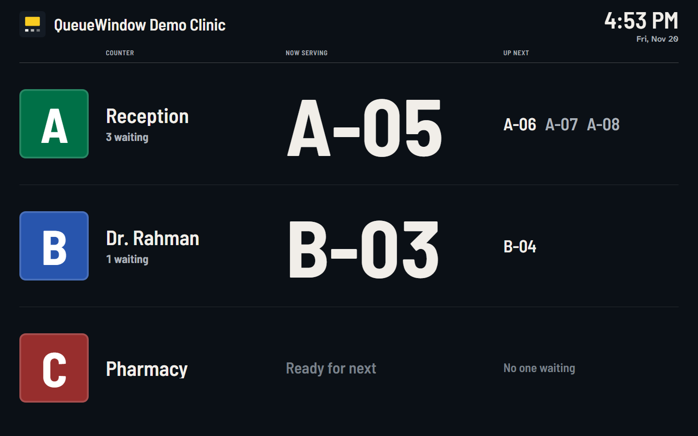

# QueueWindow

QueueWindow helps clinics, diagnostic centers, banks, and service desks manage lines without making people stand in them.
Visitors take a numbered ticket by scanning a QR code or using a kiosk.
Staff call the next number from the desk, and the waiting-room TV and visitor's phone update in real time.
Public screens work in English and বাংলা, and tickets collect no personal information.

**[Live Demo](https://queue-window.vercel.app)** · Open the shared clinic and try calling a ticket.

[](https://github.com/rkRashik/QueueWindow/actions/workflows/ci.yml)


## Preview

| TV Board | TV Spotlight |
| --- | --- |
|  |  |

**Staff Desk**


## How it works

- **Staff desk** — Issue walk-in tickets and use keyboard shortcuts to call, recall, skip, or complete them.
- **Waiting-room TV** — Choose Board, Spotlight, or Kinetic in light or dark mode, with four chimes and optional voice announcements.
- **Phone or kiosk** — Scan an A4 QR sign to take a ticket and see your place in line, or print a 58 mm or 80 mm receipt at the kiosk.
- **Language** — Switch public screens between EN, বাংলা, and Both.
- **Visitor privacy** — A ticket needs no name, phone number, or email address.
- **Separate workspaces** — Each organization has its own staff accounts, counters, and queues.

## Quick start

**Tech stack** · Next.js, TypeScript, Tailwind CSS, PostgreSQL (Neon), and Drizzle ORM.

Use Node.js 22 and a PostgreSQL database.

```sh
npm ci
cp .env.example .env.local
node -e "console.log(require('node:crypto').randomBytes(32).toString('hex'))"
```

In `.env.local`, set `DATABASE_URL` to your PostgreSQL connection string and `JWT_SECRET` to the generated key.

```sh
npx drizzle-kit migrate
npm run dev
```

Open <http://127.0.0.1:3000>.

**Testing** · Run `npm run typecheck && npm run lint && npm test`.<br>
Set `QW_TEST_DATABASE_URL` in `.env.test.local` to include PostgreSQL integration tests.

Built by **Redwanul Rashik** · [rkrashik@gmail.com](mailto:rkrashik@gmail.com)
