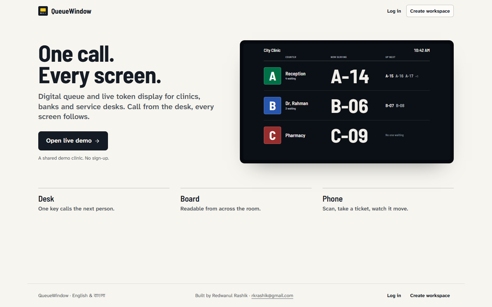
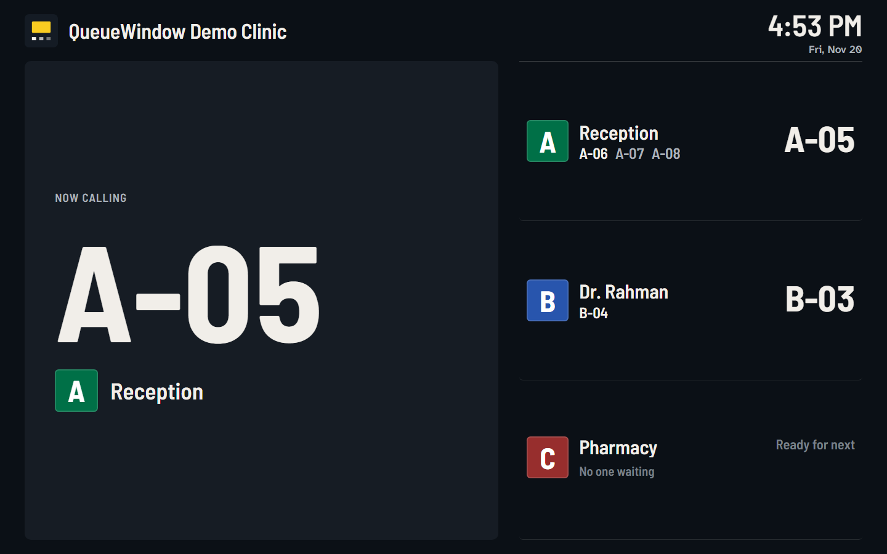
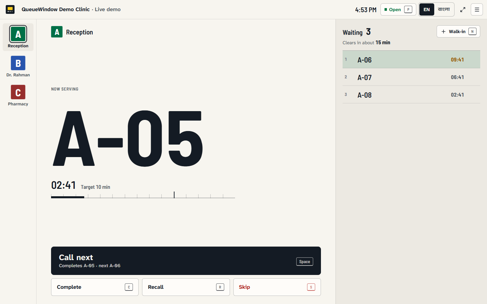
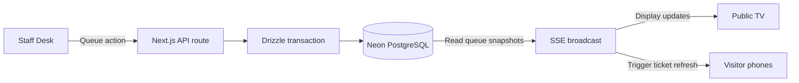

# QueueWindow

QueueWindow runs multi-counter queues for clinics, banks, and service desks, with live ticket updates on waiting-room TVs and visitors’ phones.

**[Live Demo](https://queue-window.vercel.app)** · Select **Open live demo** to use the shared clinic’s staff desk.

[](https://github.com/rkRashik/QueueWindow/actions/workflows/ci.yml)


[](https://queue-window.vercel.app)

## Product preview

| TV Board | TV Spotlight |
| --- | --- |
| [](https://queue-window.vercel.app/display/demo-clinic) | [](https://queue-window.vercel.app/display/demo-clinic?style=spotlight) |
| **Staff Desk** | |
|  | |

## Core capabilities

- **Tenant isolation and hybrid sign-in.** `orgId` scopes counters, staff, and tickets to a workspace. Owners sign in with email or username. Staff sign in with username.
- **Keyboard-first staff desk.** Switch counters, issue walk-ins, and call, recall, skip, or complete tickets from a zero-scroll desktop layout.
- **Waiting-room signage.** Board shows all counters in rows, Spotlight enlarges the latest call, and Kinetic uses animated counter cards. All three support light and dark themes, auto-hiding controls, and fullscreen.
- **Language and audio.** Public screens offer EN (default), বাংলা, and Both. The TV has four Web Audio chimes (Airport, Clinic, Bell, and Marimba), mute, and optional announcements via browser Speech Synthesis.
- **Visitor self-service and printing.** Visitors scan an A4 QR sign to take a ticket on their phone, or use an on-site kiosk with 58 mm and 80 mm thermal receipts. Tickets show queue position and estimated wait. Issuing a ticket collects zero visitor PII.
- **Demo and branding.** The shared clinic reseeds stale or abandoned demo queues on access. Free workspaces display the QueueWindow mark, and Pro workspaces can use a custom logo.

## Architecture



- **SSE over WebSockets.** Staff send mutations over HTTP, and public clients receive one-way updates over `EventSource`. The stream checks PostgreSQL every two seconds and sends a new snapshot when it changes. Browsers reconnect automatically, with a polling fallback. Phones fetch ticket details separately using their ticket URL.
- **Wait estimates.** PostgreSQL takes the median of up to 20 plausible services completed that day at the counter. It discards samples outside 15 seconds to 30 minutes and clamps the duration used in estimates to 1–30 minutes, so a ticket left open has less influence on the result.
- **Enamel and Wayfinding.** OKLCH CSS tokens define the signage palette. CSS handles call lamps, rolling tokens, and Kinetic transitions, respects reduced-motion preferences, and avoids the runtime cost of Framer Motion.
- **Database drivers.** Loopback URLs use `pg` over TCP for local development and DB-backed tests. Hosted URLs use Neon's serverless driver. Both run through Drizzle against PostgreSQL.

## Routes

| Route | Access | Purpose |
| --- | --- | --- |
| `/` | Public | Landing page and demo entry |
| `/login` · `/signup` | Public | Sign in or create a workspace |
| `/desk` | Owner or staff | Operate the queue |
| `/admin` | Owner | Counters, staff, branding, and analytics |
| `/display/[orgSlug]` | Public | Live TV signage with `?style=board`, `?style=spotlight`, or `?style=kinetic` |
| `/join/[orgSlug]` | Public | Take a ticket on a phone |
| `/join/[orgSlug]/ticket/[ticketId]` | Ticket URL | Follow a ticket’s status, position, and wait |
| `/kiosk/[orgSlug]` | Public | Take and print a thermal ticket |
| `/print/[orgSlug]/qr` | Public | Print an A4 QR sign |
| `GET /robots.txt` · `/sitemap.xml` · `/manifest.webmanifest` · `/opengraph-image` · `/icon.svg` · `/icon-192.png` · `/icon-512.png` | Public | Crawler, share, and install metadata |
| `POST /api/auth/{signup,login,demo,logout}` | Public, same origin | Create, start, or end a session |
| `GET /api/auth/me` | Owner or staff | Current session identity |
| `GET /api/desk/state` · `POST /api/desk/action` | Owner or staff | Read and operate the queue |
| `GET, POST /api/admin/counters` · `PATCH, DELETE /api/admin/counters/[id]` | Owner | Manage counters |
| `GET, POST /api/admin/staff` · `DELETE /api/admin/staff/[id]` | Owner | Manage staff accounts |
| `PATCH /api/admin/organization` · `GET /api/admin/analytics` | Owner | Update workspace settings and read analytics |
| `GET /api/public/[orgSlug]/{display,stream}` · `POST /api/public/[orgSlug]/join` | Public | Display snapshot, SSE feed, and ticket issuance |
| `GET /api/public/[orgSlug]/ticket/[ticketId]` | Ticket URL | Read a visitor’s live ticket |

## Tech stack

Next.js App Router, React, and TypeScript. PostgreSQL on Neon with Drizzle ORM and Drizzle Kit. Tailwind CSS and native CSS for styling and motion. Vitest and Playwright for testing, GitHub Actions for CI, and Vercel for hosting.

## Local setup

Use Node.js 22 and either a Neon database or a local PostgreSQL instance. From the repository root, install dependencies and generate a signing key.

```sh
npm ci
cp .env.example .env.local
node -e "console.log(require('node:crypto').randomBytes(32).toString('hex'))"
```

In `.env.local`, set `DATABASE_URL` to your database connection string and `JWT_SECRET` to the generated key. Leave `APP_URL` empty locally. New workspaces default to Free. Set `QW_TRIAL_DAYS=14` to enable 14-day trials for new signups.

```sh
npx drizzle-kit migrate
npm run dev
```

Open <http://127.0.0.1:3000> and create a workspace or open the live demo.

## Testing

Set the following in the gitignored `.env.test.local` using dedicated loopback PostgreSQL databases.

| Variable | Used by | Database setup |
| --- | --- | --- |
| `QW_TEST_DATABASE_URL` | Vitest integration suite | The suite applies migrations in a throwaway schema. |
| `QW_E2E_DATABASE_URL` | Playwright journeys | Apply the migrations first. The public journey resets `demo-clinic` in this database. |

With `QW_E2E_DATABASE_URL` exported in your shell, prepare that database with `DATABASE_URL="$QW_E2E_DATABASE_URL" npx drizzle-kit migrate`.

Run the checks and build before starting Playwright. Playwright's web server runs the production build.

```sh
npm run typecheck
npm run lint
npm test
npm run build
npx playwright install chromium
npm run test:e2e
```

## Deployment

- [ ] Import the repository as a Next.js project in Vercel and set Node.js to 22. For a Singapore rollout, select `sin1` for Vercel Functions and provision Neon in `ap-southeast-1`. [Vercel regions](https://vercel.com/docs/regions) · [Neon regions](https://neon.com/demos/regional-latency)
- [ ] Set `DATABASE_URL` to the Neon connection string with SSL enabled, generate a production-only `JWT_SECRET`, and set `APP_URL` to the public HTTPS origin. Use isolated databases and environment settings for previews.
- [ ] Run `npx drizzle-kit migrate` with `DATABASE_URL` pointed at the target database before routing traffic to the deployment.
- [ ] Open the demo desk, join from a phone, and call the next ticket. Check that the TV updates and the matching phone ticket shows the call.

## Author

**Redwanul Rashik** · [rkrashik@gmail.com](mailto:rkrashik@gmail.com)
